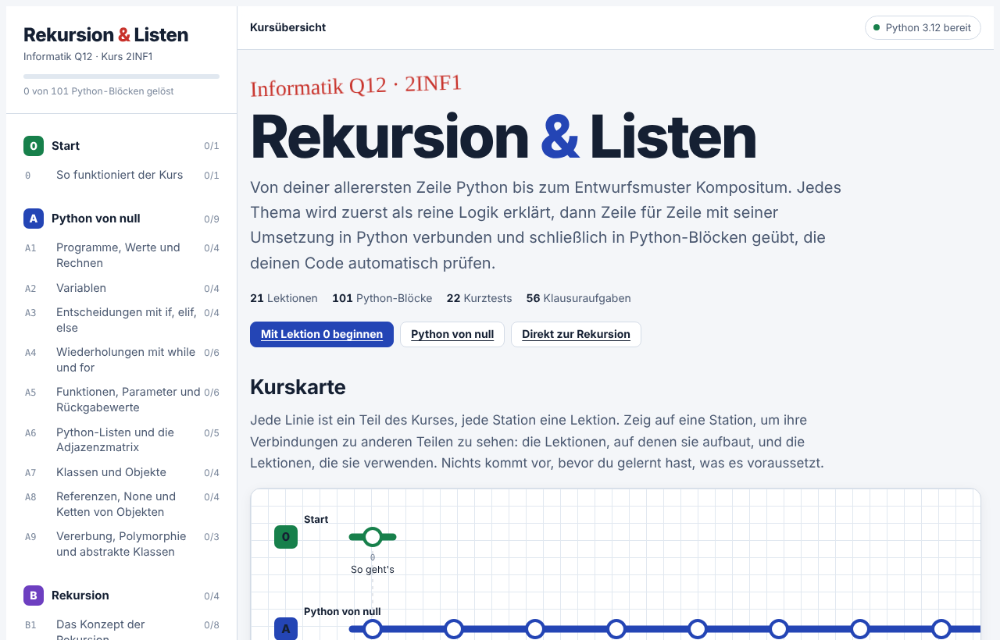
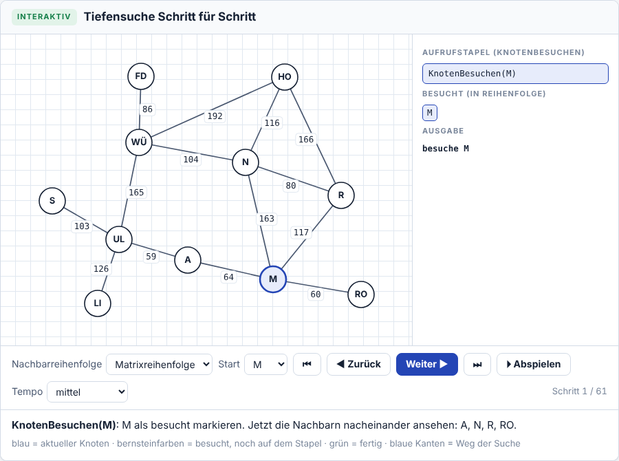
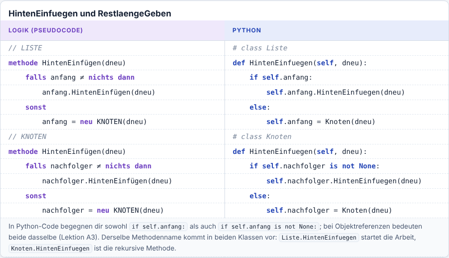

# Rekursion & Listen

An interactive course for Informatik Q12 (Bavarian Gymnasium, Kurs 2INF1). It covers
**Python from zero**, **Rekursion** (topic I), **Listen and Stapel** (topic II) and
**Bäume** (topic III), and ends with exam preparation. Every topic is first explained as pure logic, then connected line
by line to its Python implementation, and then practised in Python blocks that check
your code automatically. The course text is in German.



- **26 lessons** in six parts
- **128 Python blocks** with automatic checks, hints and model solutions
- **29 quizzes**, **105 exam tasks** with model solutions, and two full mock exams
- **29 interactive visualisations**: call stack, Türme von Hanoi, Levy-C-Kurve,
  Damenproblem, Rucksackproblem, Sudoku, Tiefensuche/Breitensuche, all paths and
  Handlungsreisender, labyrinth, queue and list operations, stack operations,
  Cheese-Champions, the guessing game, and inserting, searching and traversing in
  ordered binary trees
- **Step-by-step tracer** for Python code that shows frames, objects and references
  as arrows
- **Logic ↔ Python bridges**: pseudocode and Python side by side, row by row
- **Python runs in the browser** with Python 3.12 via Pyodide, so there is nothing
  to install and your code never leaves your computer
- Error messages are explained in German. Progress is saved in the browser.

| Part | Lessons |
|---|---|
| **0 Start** | 0 So funktioniert der Kurs |
| **A Python von null** | A1 Programme, Werte und Rechnen · A2 Variablen · A3 Entscheidungen mit if, elif, else · A4 Wiederholungen mit while und for · A5 Funktionen, Parameter und Rückgabewerte · A6 Python-Listen und die Adjazenzmatrix · A7 Klassen und Objekte · A8 Referenzen, None und Ketten von Objekten · A9 Vererbung, Polymorphie und abstrakte Klassen |
| **B Rekursion** | B1 Das Konzept der Rekursion · B2 Backtracking · B3 Graphen und Tiefensuche · B4 Anwendungen der Tiefensuche: optimale Lösungen |
| **C Listen** | C1 Die Warteschlange · C2 Trennung von Struktur und Daten · C3 Die einfach verkettete Liste · C4 Entwurfsmuster Kompositum · C5 Der Stapel |
| **D Bäume** | D1 Die Datenstruktur Baum · D2 Suchen und Einfügen im geordneten Binärbaum · D3 Binärbaum mit dem Kompositum implementieren |
| **E Klausurvorbereitung** | E1 Spickzettel und Glossar · E2 Gemischte Aufgaben · E3 Probeklausur 1 · E4 Probeklausur 2 |

<p>
  
  
</p>


## Using the course

The finished course is the folder [`docs/`](docs). It is a static website with no
backend.

### Online with GitHub Pages

1. In this repository, open **Settings → Pages**.
2. Under "Build and deployment", choose **Deploy from a branch**, branch **main**,
   folder **/docs**, and save.
3. After a minute, the course is live at `https://<your-user-name>.github.io/<repository-name>/`.

GitHub Pages is free for public repositories. Private repositories need a paid GitHub
plan for it.

### Offline on your own computer

Download the repository (**Code → Download ZIP**) and unzip it. Then start
`docs/start.bat` (Windows) or `docs/start.command` (macOS), or run `python3 docs/start.py`.
This starts a tiny local web server and opens the course in your browser.
It needs Python 3.7 or newer and no internet connection.
Full instructions and troubleshooting are in [`docs/README.md`](docs/README.md).

Opening `docs/index.html` directly by double-click shows the lessons, but the Python
blocks will not run. Browsers do not let a page opened as a local file load the
Python runtime.


## Project structure

```
├── src/                     sources (edit these)
│   ├── lessons/*.md         the 26 lessons (Markdown + course blocks, see below)
│   ├── subjects.json        order of the course subjects
│   ├── course_subjects/     one subject class per module + shared abstract base
│   ├── index.template.html  page layout and all CSS
│   ├── engine.js            app: navigation, Python blocks, checks, error explanations, progress
│   ├── viz.js               the interactive visualisations
│   ├── tracer.js            step-by-step Python tracer
│   ├── diagrams.js          SVG diagrams from a small text format
│   ├── harness.py           test helpers and tracer backend (runs inside Pyodide)
│   ├── build.py             builds docs/ from the sources
│   └── validate.py          runs every model solution and starter against its tests
├── docs/                    the finished course (GitHub Pages / offline folder)
│   ├── index.html, content.js, *.js     generated by build.py, do not edit
│   ├── lib/codemirror/      code editor, copied by build.py
│   ├── pyodide/             Python 3.12 for the browser (checked in, not generated)
│   ├── start.py, start.bat, start.command, README.md   offline starter (checked in)
│   └── .nojekyll            tells GitHub Pages to serve the files as they are
├── vendor/codemirror/       CodeMirror 5.65.16 (editor) and its CSS
├── tests/smoke.js           browser test with Playwright
├── assets/                  screenshots for this README
└── requirements.txt         Python packages for build.py
```


## Building from source

You need Python 3.10 or newer (3.12 matches the browser).

```bash
pip install -r requirements.txt
python3 src/build.py      # writes docs/index.html, docs/content.js, copies the JS and CodeMirror
python3 src/validate.py   # every model solution must pass its tests, every starter must not
```

`validate.py` prints `problems: 0` when everything is consistent. It writes nothing.
You can limit it to some exercises with `python3 src/validate.py b3 c4`.

Browser smoke test (Node.js 18+):

```bash
cd tests
npm install
npx playwright install chromium
npm test                  # every lesson loads without console errors
npm run test:python       # also runs real checks in the browser's Python
H=b3 SEL=".viz" OUT=shot.png node smoke.js --shot   # screenshot of one element
```


## Writing lessons

Each file in `src/lessons/` starts with YAML front matter:

```yaml
---
id: b1                  # used in links (#b1) and in "uses"
num: B1
part: B                 # 0, A, B, C, D or E
title: Das Konzept der Rekursion
short: Rekursion Konzept   # label on the course map
lead: One paragraph shown under the title.
minutes: 90
uses: [a5, a4, a1]      # lessons this one builds on (drawn on the course map)
goals:
  - what the learner can do afterwards
---
```

The subjects/parts shown in the course navigation are ordered in
[`src/subjects.json`](src/subjects.json). Each module in `src/course_subjects/` defines
one concrete subclass of `Subject`; the shared base validates its display metadata.
Each lesson's `part` value must match one of those subject IDs, and lesson membership
stays in the lesson files.

The body is Markdown. A section heading can carry a phase tag, which colours it and
shows up in the table of contents: `## [logic] …`, `## [bridge] …`, `## [python] …`,
`## [exam] …`, `## [intro] …`. Code fences can be `python`, `pseudo` (teacher-style
pseudocode with highlighted keywords) or `out` (program output).

Course blocks are fenced with `:::`. When blocks are nested, the outer fence needs
more colons (`::::`).

| Block | What it does |
|---|---|
| `:::exercise id=… title="…" level=1` | Python block with sections `--- starter`, `--- solution`, `--- tests`, `--- hint` (repeatable) and `--- explain` |
| `:::quiz` | Question, options `- [ ]` / `- [x]`, then `--- explain` |
| `:::exam title="…" points=4` | Exam task, then `--- solution` with the model solution |
| `:::note`, `:::key`, `:::warn`, `:::tip` | Callout boxes (optional `title="…"`) |
| `:::bridge title="…"` | Rows `pseudocode \|\| python`; rows starting with `>>` are explanations |
| `:::diagram kind [wide] caption="…"` | Diagram from a text description. Kinds: `objects`, `classes`, `seq`, `matrix`, `struktogramm`, `graph`, `calltree`, `board`, `bintree` (formats in `diagrams.js`) |
| `:::viz name` + JSON config | Interactive visualisation: `recstack`, `hanoi`, `levy`, `queens`, `knapsack`, `sudoku`, `graphwalk`, `paths`, `maze`, `listops`, `stack`, `mice`, `guess`, `bst` |
| `:::trace title="…"` | Python code for the step-by-step tracer |
| `:::cols [cards]` | Columns, separated by `--- col` |

An exercise looks like this:

```
:::exercise id=a5-square title="Deine erste Funktion" level=1
Schreib eine Funktion `quadrat(x)`, die `x * x` **zurückgibt**.
--- starter
def quadrat(x):
    pass
--- solution
def quadrat(x):
    return x * x
--- tests
@test("quadrat(7) gibt 49 zurück")
def _():
    eq(quadrat(7), 49, "quadrat(7)")
--- hint
Ersetze `pass` durch eine `return`-Anweisung.
--- explain
`pass` tut nichts, deshalb gibt die Startfunktion `None` zurück.
:::
```

Tests run in the same namespace as the learner's code. Helpers from `harness.py`:

| Helper | Meaning |
|---|---|
| `@test("name")` | registers a check; the name is shown to the learner |
| `eq(actual, expected, what)` | fails with "*what*: erwartet …, erhalten …" |
| `ok(condition, message)` | fails with *message* |
| `printed(fn)` | runs `fn()` and returns what it printed |
| `lines(text)` | splits output into lines without trailing spaces |
| `recursive(fn, *args)` | returns `(result, True/False)`: did `fn` really call itself? |
| `max_depth_of(code_objects, fn)` | runs `fn()` and returns how deeply frames of these functions were nested |
| `has_method(cls, name)` | does the class have this method (own or inherited)? |
| `SOURCE`, `OUTPUT` | the learner's code and what it printed |
| `run_again(var=value, …)` | reruns the program with other start values for top-level variables |

Python blocks are limited to 5 million steps and 60,000 printed characters, so an
endless loop is stopped and explained instead of freezing the page.


## Third-party software

- [Pyodide](https://pyodide.org) 0.27.7, Mozilla Public License 2.0, which includes
  CPython 3.12 (PSF License). The standard library archive is stored base64-encoded as
  `docs/pyodide/python_stdlib.b64.txt` and decoded by `engine.js`.
- [CodeMirror](https://codemirror.net/5/) 5.65.16, MIT License (`vendor/codemirror/LICENSE`)
- Fonts from Google Fonts (Atkinson Hyperlegible, Bricolage Grotesque, Caveat,
  JetBrains Mono). They are loaded online when available; without internet the
  browser's own fonts are used.

The course content follows the Informatik course 2INF1 (Q12, Gymnasium Bayern) and
its teacher's materials and naming conventions.
